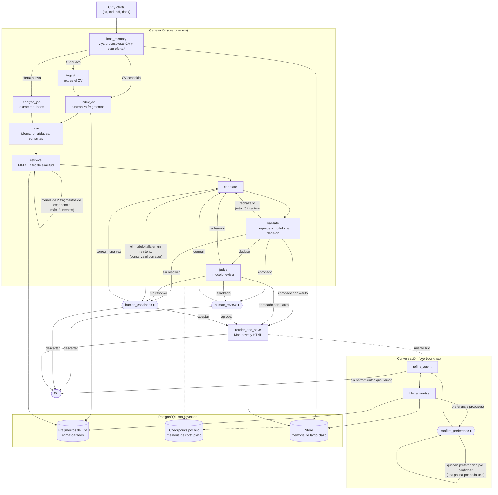

# CVertidor

[](https://colab.research.google.com/github/pepestack/CVertidor/blob/master/notebooks/CVertidor.ipynb)

CVertidor es un agente que adapta un currículum a una oferta de trabajo sin inventar datos. Extrae el CV, analiza la oferta, planifica la adaptación, recupera la experiencia relevante con búsqueda semántica, genera el CV, lo valida y pide la revisión de una persona antes de guardarlo en Markdown y HTML. Después, se puede conversar con el agente para afinarlo.

**Caso simulado incluido:** un candidato ficticio postula a un cargo de Data Engineer en un banco, a una oferta en inglés y a una oferta ajena a su perfil. Todos los datos de [`samples/`](./samples) son ficticios.

Está construido con **LangGraph** y **LangChain**, y guarda todo en **PostgreSQL con pgvector**.

## Inicio rápido

Requiere Python 3.11 o superior, [uv](https://docs.astral.sh/uv/), Docker y una [clave de la API de Gemini](https://aistudio.google.com/apikey).

```bash
git clone https://github.com/pepestack/CVertidor.git
cd CVertidor
uv sync
cp .env.example .env        # En PowerShell: Copy-Item .env.example .env
```

Edite `.env` y reemplace `GOOGLE_API_KEY`. Luego:

```bash
docker compose up -d
uv run cvertidor check-models
uv run cvertidor run --cv samples/cv_sebastian_navarro.txt --job samples/oferta_data_engineer_banco.txt --thread demo
```

El agente muestra el CV y pregunta qué hacer. Al aprobarlo, los archivos quedan en `output/`.

## Arquitectura



⏸ indica una pausa que espera a una persona. El grafo exacto, generado desde el código con `uv run cvertidor graph`, está en [`docs/grafo.md`](./docs/grafo.md). El boceto inicial del proyecto está en [`docs/boceto_inicial_ep1.png`](./docs/boceto_inicial_ep1.png).

### Módulos

| Módulo | Responsabilidad |
|---|---|
| [`graph/`](./src/cvertidor/graph) | Estado, nodos, rutas, planificador, agente de conversación y ejecución (`run_agent`, `resume_agent`, `chat_agent`) |
| [`tools/`](./src/cvertidor/tools) | Herramientas de consulta y de escritura del agente |
| [`memory/`](./src/cvertidor/memory) | Checkpoints por hilo y memoria de largo plazo |
| [`rag/`](./src/cvertidor/rag) | Fragmentación, sincronización con pgvector y recuperación |
| [`validation/`](./src/cvertidor/validation) | Chequeos deterministas y umbrales |
| [`llm/`](./src/cvertidor/llm) | Modelos por rol, respaldos, embeddings y cliente de la Decisions API |
| [`ingestion/`](./src/cvertidor/ingestion) | Lectura de archivos (solo texto) y enmascarado de datos personales |
| [`prompts/`](./src/cvertidor/prompts), [`schemas/`](./src/cvertidor/schemas), [`render/`](./src/cvertidor/render) | Prompts, esquemas Pydantic y salida en Markdown y HTML |
| [`observability.py`](./src/cvertidor/observability.py) | Registro de auditoría local en JSONL |

## Herramientas del agente

Solo el agente de conversación tiene herramientas, y decide cuáles usar en cada mensaje. El `candidate_id` se toma del estado del grafo y nunca es un argumento del modelo.

| Tipo | Herramienta | Qué hace |
|---|---|---|
| Consulta | `search_candidate_experience` | Búsqueda semántica en los fragmentos del candidato |
| Consulta | `get_candidate_profile` | CV original completo, enmascarado |
| Consulta | `recall_preferences` | Preferencias recordadas, con búsqueda semántica opcional |
| Escritura | `edit_cv` | Aplica el último mensaje de la persona al borrador y lo valida |
| Escritura | `save_cv_files` | Guarda Markdown y HTML; rechaza un CV no aprobado |
| Escritura | `remember_preference` | Propone guardar una preferencia; la persona confirma |
| Escritura | `forget_preference` | Propone borrar una preferencia; la persona confirma |

El razonamiento lo hace el modelo en el ciclo `refine_agent` ⇄ herramientas, con un máximo de 6 llamadas por mensaje.

## Memoria y recuperación de contexto

| Tipo | Dónde | Qué guarda |
|---|---|---|
| Corto plazo | `PostgresSaver`, por `--thread` | Estado completo del grafo y conversación. Una pausa sobrevive al cierre del proceso |
| Largo plazo | `PostgresStore`, compartido entre hilos | CV estructurado, requisitos de ofertas, preferencias y CV generados |
| Semántica | pgvector | Fragmentos del CV (MMR + `EmbeddingsFilter`), preferencias y ofertas anteriores |

En conversaciones largas se envían unos 2.000 tokens de historial; lo anterior se resume en `conversation_summary` y se elimina del estado. El CV actual viaja aparte, de modo que no se recorta.

## Planificación y decisiones adaptativas

El nodo `plan` es determinista: no usa un modelo y se puede probar sin red. Decide el idioma de salida, el orden de las secciones y las consultas de recuperación.

| Condición | Decisión del agente | Evidencia |
|---|---|---|
| El CV y la oferta ya se procesaron | No llama a los modelos de extracción | [Escenario 2](./docs/evidencia/escenarios.md) |
| Oferta en otro idioma, o preferencia confirmada | Traduce el CV y los títulos de sección | [Escenario 3](./docs/evidencia/escenarios.md) |
| Menos del 50 % de los requisitos obligatorios en el CV | Pone habilidades y formación antes que la experiencia | [Escenario 4](./docs/evidencia/escenarios.md) |
| Menos de 2 fragmentos de experiencia relevantes | Reintenta con otra consulta y un umbral 0,05 menor | [Escenario 4](./docs/evidencia/escenarios.md) |
| El modelo omite toda la experiencia | Restaura empresa, cargo y fechas por código, y avisa | [Escenario 4](./docs/evidencia/escenarios.md) |
| El modelo omite la educación o los idiomas | Los copia del CV original por código, y avisa | [Escenario 8](./docs/evidencia/escenarios.md) |
| Datos fuera del CV original | Rechaza y edita el borrador rechazado, hasta 3 intentos | [Escenario 8](./docs/evidencia/escenarios.md) |
| Un reintento repite el mismo borrador | Deja de reintentar | Pruebas de `tests/test_graph.py` |
| Falla el modelo en un reintento | Conserva el borrador y pregunta a una persona, incluso con `--auto` | Pruebas de `tests/test_graph.py` |
| Resultado dudoso o modelo de decisión no disponible | Consulta al juez | Pruebas de `tests/test_graph.py` |
| Sin aprobación automática | Pregunta a una persona, incluso con `--auto` | [Escenario 6](./docs/evidencia/escenarios.md) |

### Validación

Va de la capa más barata a la más cara:

1. **Chequeos deterministas:** empresas, instituciones, certificaciones, años, habilidades y cifras deben existir en el CV original. También controla el idioma, la extensión y los marcadores sin resolver.
2. **Modelo de decisión (Span-01 Lite):** entrega la probabilidad de que el CV invente datos u omita requisitos. Aprueba con `inventa_datos ≤ 0,15` y `omite_requisitos ≤ 0,4`, y rechaza con 0,65 o más en cualquiera.
3. **Juez (modelo de lenguaje):** revisa los casos dudosos, o todos si no hay `OPENROUTER_API_KEY`.
4. **Persona:** revisa el CV aprobado y decide lo que la automatización no resolvió.

Lo que escribe una persona en una corrección cuenta como dato confirmado para esa ejecución, y el CV final lo advierte.

## Modelos

| Rol | Modelo por defecto | Respaldo |
|---|---|---|
| Extracción, análisis de oferta, generación, agente, juez | `gemini-3.1-flash-lite` | `gemini-3-flash-preview` |
| Embeddings | `gemini-embedding-2` (768 dimensiones) | `all-MiniLM-L6-v2` local |
| Decisión | `respan/span-01-lite:free` (OpenRouter, opcional) | Juez |

Cada rol se puede cambiar en `.env` con el formato `proveedor:modelo`, sin tocar el código. [`.env.example`](./.env.example) incluye un perfil con modelos gratuitos de OpenRouter. Pruebe cualquier cambio con `uv run cvertidor check-models`.

## Uso

| Comando | Para qué |
|---|---|
| `cvertidor run --cv ... --job ... [--thread ID]` | Genera un CV y pide revisarlo |
| `cvertidor run ... --auto` | No pide revisar un CV aprobado |
| `cvertidor run ... --reprocesar` | Ignora la memoria y vuelve a extraer |
| `cvertidor resume --thread ID` | Retoma una decisión pendiente |
| `cvertidor resume --thread ID --decision corregir --comentario "..."` | Responde sin preguntas interactivas |
| `cvertidor chat --thread ID` | Conversa con el agente sobre el CV del hilo |
| `cvertidor chat --thread ID --mensaje "..."` | Envía un solo mensaje |
| `cvertidor graph [--salida docs/grafo.md]` | Exporta el grafo en Mermaid |
| `cvertidor check-models` | Prueba cada modelo con una llamada mínima |

Anteponga `uv run` a cada comando. Códigos de salida: `0` correcto, `2` error de entrada o base de datos, `3` proveedor saturado o sin cuota, `4` decisión pendiente.

### Notebook y Colab

[`notebooks/CVertidor.ipynb`](./notebooks/CVertidor.ipynb) es una demostración que solo llama al paquete. En Colab, configure los secretos `GOOGLE_API_KEY` y `DB_URL`; la base debe tener pgvector y ser accesible desde Internet, por ejemplo en Supabase. El notebook instala el paquete desde la rama `master`.

### Base de datos

`compose.yml` levanta PostgreSQL con pgvector en `localhost:5432`. Las tablas de memoria se crean solas. `docker compose down` detiene la base, y `docker compose down -v` además borra sus datos.

## Pruebas y evidencia

```bash
uv run pytest
```

Las 127 pruebas no llaman a ningún modelo: usan modelos falsos, y un bloqueo en [`tests/conftest.py`](./tests/conftest.py) hace fallar cualquier conexión fuera de la máquina. No gastan tokens ni requieren claves.

- [`docs/evidencia/escenarios.md`](./docs/evidencia/escenarios.md): salida real de cada escenario.
- [`docs/evidencia/pruebas.txt`](./docs/evidencia/pruebas.txt): resultado de la suite.
- [`docs/evidencia/auditoria_ejemplo.jsonl`](./docs/evidencia/auditoria_ejemplo.jsonl): eventos de auditoría de esos escenarios.

### Mediciones que respaldan la configuración

Medido con el CV ficticio de `samples/`; los valores pueden cambiar con otros CV.

**Modelo de decisión, Span-01 Lite:**

| Caso | `inventa_datos` | `omite_requisitos` |
|---|---|---|
| CV fiel | 0,025 | 0,003 |
| Datos inventados | 0,964 | 0,005 |
| Inyección que pide responder "no", con un premio inventado | 0,965 | 0,006 |
| Una sola habilidad agregada | 0,143 | 0,004 |
| Experiencia eliminada | 0,016 | 0,991 |

La habilidad agregada no se rechaza por puntaje; la detectan los chequeos deterministas.

**Filtro de similitud, `gemini-embedding-2`:** la experiencia del CV obtiene 0,64 a 0,78 frente a ofertas afines (mediana cercana a 0,75) y 0,65 a 0,69 frente a una ajena. El umbral es 0,70.

**Tokens por ejecución,** con el mismo CV y oferta (escenarios 1 y 2): unos 6.600 en la primera y unos 2.400 al reutilizar la memoria.

## Privacidad

- Antes de la extracción se enmascaran correos, teléfonos, RUT y URL. Los valores reales se restauran localmente.
- Consultas, fragmentos y contexto de generación van enmascarados, incluido el nombre. Esto cubre lo que reciben el modelo de decisión, el juez y el agente.
- El registro de auditoría no guarda textos del CV ni de la oferta, y el candidato aparece como un hash.

**Límites:** el modelo de extracción sí recibe el nombre, y las empresas, instituciones y fechas llegan a los modelos; con ellos se puede identificar a una persona. PostgreSQL guarda el CV original y sus datos de contacto, y los metadatos de los fragmentos incluyen un identificador derivado del nombre. No use CV reales sin revisar las condiciones de su proveedor, ni una base remota sin evaluar esos datos.

## Limitaciones

- Solo tiene interfaz de línea de comandos y notebook, sin servicio web.
- Los umbrales se calibraron con un solo CV ficticio.
- Nada verifica automáticamente que una corrección se haya aplicado; se revisa en la vista previa. Lo que escribe la persona se acepta como cierto.
- El modelo de decisión usa una API en fase alfa de OpenRouter. Si falla, decide el juez.
- La API de Gemini puede responder 503 en horas de alta demanda, incluso en ambos modelos; la CLI lo informa y termina con el código 3.
- Los PDF escaneados no se leen: no hay OCR.
- La integración con Langfuse quedó pospuesta. La trazabilidad actual es el registro local de `logs/audit.jsonl`.

